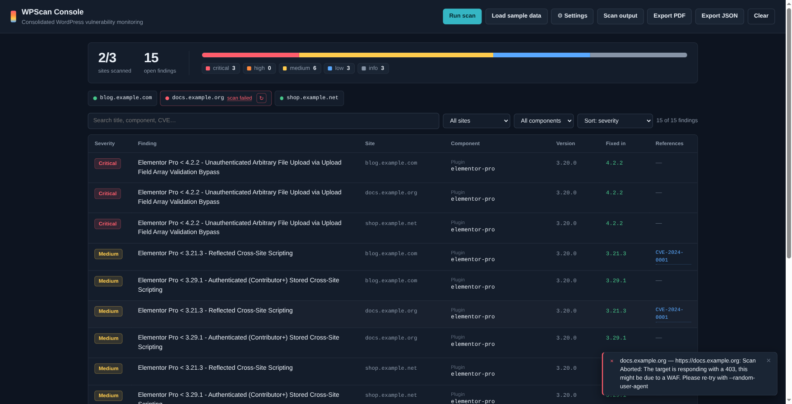
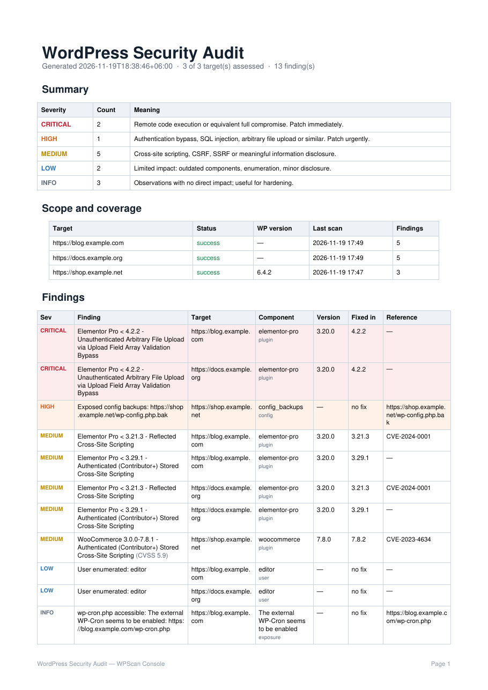
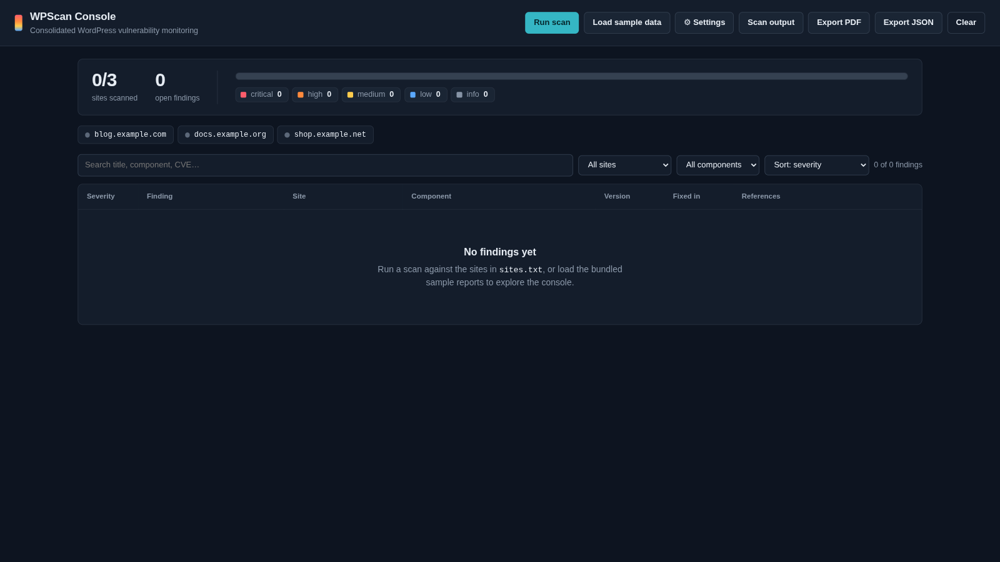
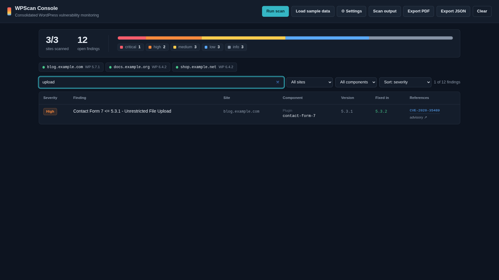

# WPScan Console

A single-user security dashboard that runs [WPScan](https://wpscan.com/)
against your WordPress sites (or ingests existing WPScan JSON reports),
aggregates every finding into one filterable, severity-ranked view, and exports
a client-ready PDF or JSON audit report.

> ⚠️ **Only scan sites you own or are explicitly authorized to test.** Running a
> vulnerability scanner against systems without permission may be illegal.

## 🎬 Video user manual

[](docs/media/user-manual.mp4)

*A 2:40 walkthrough of setup, the dashboard, running and controlling scans, and
the PDF/JSON reports. Click the image to play
([download the MP4](docs/media/user-manual.mp4)).*

## 📸 Screenshot tour

| | | |
|:---:|:---:|:---:|
| [](#32-reading-the-dashboard)<br>**Dashboard** | [](#42-start-a-scan)<br>**Live scan** | [](#43-pause-resume-and-cancel)<br>**Pause / cancel** |
| [](#41-tune-the-settings-optional)<br>**Settings** | [](#8-troubleshooting)<br>**Failed target** | [](#5-exporting-the-audit-report)<br>**PDF report** |

*All screenshots use the bundled `example.*` sample sites.*

---

## Contents

1. [Quick start](#1-quick-start)
2. [Installation and configuration](#2-installation-and-configuration)
3. [Using the dashboard](#3-using-the-dashboard)
4. [Running scans](#4-running-scans)
5. [Exporting the audit report](#5-exporting-the-audit-report)
6. [What it checks](#6-what-it-checks)
7. [How severity is decided](#7-how-severity-is-decided)
8. [Troubleshooting](#8-troubleshooting)
9. [Configuration reference](#9-configuration-reference)
10. [API reference](#10-api-reference)
11. [Architecture](#11-architecture)
12. [Deployment and security](#12-deployment-and-security)

---

## 1. Quick start

```bash
cd wpscan-dashboard
python3 -m venv .venv && source .venv/bin/activate
pip install -r requirements.txt
python app.py
```

Open <http://127.0.0.1:5000> and click **Load sample data** to explore the
console immediately — no WPScan install, API key, or live targets needed. The
sample data comes from the bundled reports in `sample_scans/`; nothing is
contacted.

---

## 2. Installation and configuration

### 2.1 Install WPScan

Live scanning needs the WPScan CLI (Ruby gem or the official Docker image):

```bash
gem install wpscan
```

### 2.2 Add WPScan API keys

Vulnerability data comes from the WPScan API. Get free keys at
<https://wpscan.com/profile>, then:

```bash
cp api_keys.txt.example api_keys.txt   # then put one key per line
python scanner.py                      # shows which keys were loaded (masked)
```

- The free plan allows **25 requests per key per day**.
- The current key is reused across sites. When WPScan rejects it or reports its
  limit, it is retired for the session and the scan retries with the next key.
- Keys are re-read at the start of every batch — no restart needed after edits.
- A single `WPSCAN_API_TOKEN` environment variable is also supported and is
  tried first.
- `api_keys.txt` is gitignored. **Never commit real keys.**

Without keys WPScan still enumerates the site, but returns little or no
vulnerability data.

### 2.3 Add your targets

Put the sites you are authorized to scan in `sites.txt`, one URL per line.
Lines starting with `#` are ignored, a missing scheme defaults to `https://`,
and duplicate entries are scanned only once.

---

## 3. Using the dashboard

### 3.1 First run



On first launch the dashboard is empty:

1. **Header buttons** (top right): **Run scan** · **Load sample data** ·
   **⚙ Settings** · **Scan output** (live console) · **Export PDF** ·
   **Export JSON** · **Clear**.
2. **Summary band** shows `0/N sites scanned` — N is the number of targets in
   `sites.txt`.
3. **Site chips** list every configured target as *not scanned*.
4. The **empty-state message** points you to `sites.txt` or the sample data.

Click **Load sample data** for an instant demo, or **Run scan** once your
targets and API keys are set up.

### 3.2 Reading the dashboard


1. **Sites scanned / open findings** — how many targets have a successful scan,
   and how many findings are currently open across all of them.
2. **Severity bar and legend** — the share of findings per severity
   (critical · high · medium · low · info). Click a legend chip to hide or show
   that severity in the table.
3. **Site chips** — one per target. The dot shows its status (green success,
   amber partial, red failed, grey not scanned) next to the detected WordPress
   version.
4. **Findings table** — every finding ranked worst first:

   | Column | Meaning |
   |---|---|
   | **Severity** | Critical → info ([how it's decided](#7-how-severity-is-decided)). Tags like `exposure` or `outdated` mark non-CVE findings; a `CVSS` score is shown when WPScan provides one. |
   | **Finding** | The vulnerability or exposure title. |
   | **Site** | Which target it was found on. |
   | **Component** | Type (core · plugin · theme · config · user) and name, e.g. `plugin` / `contact-form-7`. |
   | **Version** | The installed version WPScan detected. |
   | **Fixed in** | The first version that fixes it (green), or `no fix`. Upgrading to at least this version resolves the finding. |
   | **References** | CVE IDs and advisory links. |

### 3.3 Search, filter and sort



- **Search box** — matches finding titles, component names and CVE IDs as you
  type. Above, searching `upload` narrows 12 findings to the 2 file-upload
  issues.
- **All sites** — show findings for one target only.
- **All components** — show only core, plugin, theme, config, server or user
  findings.
- **Sort** — by severity (default), site, component type, or component name.
- The counter on the right (`2 of 12 findings`) shows how much is filtered out.

### Load or clear data

- **Load sample data** imports the bundled JSON reports (no scan is run).
- To ingest your own reports, drop WPScan JSON files (made with
  `wpscan --url … --format json -o report.json`) into `sample_scans/` (or set
  `SAMPLE_DIR`) and click **Load sample data**.
- **Clear** deletes stored scans and findings. It does not touch `sites.txt` or
  `api_keys.txt`.

---

## 4. Running scans

### 4.1 Tune the settings (optional)


Open **⚙ Settings** before a batch:

| Setting | Effect |
|---|---|
| **Pre-flight site check** | Checks reachability and a WordPress fingerprint first, so unreachable or non-WordPress targets don't spend API quota. |
| **Pre-flight timeout** | How long the pre-flight check waits. |
| **Scan timeout** | When WPScan is stopped. Findings gathered so far are kept and the site is marked **partial**. |
| **Plugin detection** | `aggressive` (thorough, slow) · `mixed` (balanced) · `passive` (fast). |
| **Enumeration flags** | WPScan `--enumerate` value; default `vp,vt,u,cb,dbe`. |

Settings live in memory and reset when the server restarts. For permanent
defaults use the [environment variables](#9-configuration-reference).

### 4.2 Start a scan


1. Click **Run scan** and confirm that you are authorized to scan the targets.
2. Sites are scanned **one at a time**, in the order of `sites.txt`. Sequential
   scanning keeps pauses predictable and spends API quota one site at a time.
3. The **Scan output** console opens and streams WPScan's live progress (API
   token masked). Findings appear in the table as soon as they are found.
4. Toast notifications report scan start, each target, key rotation, and the
   batch summary.

What you see in the screenshot above:

- **Header** — `Scanning… 1/3` progress, plus **⏸ Pause** and **✕ Cancel**.
- **Site chips** — the active site says *scanning…*; the others say *queued*,
  each with a ⏸ button to hold it before it starts.
- **Findings table** — already shows the new Elementor Pro findings for the
  first site while the second is still being scanned.
- **Scan output** panel (right) — WPScan's live progress for the current site.

Each successful scan is followed by the passive
[web-hygiene checks](#6-what-it-checks).

### 4.3 Pause, resume and cancel


**Batch controls** (in the header while scanning):

- **⏸ Pause** — holds after the current site finishes. A running scan is never
  interrupted mid-flight.
- **▶ Resume** — continues with the next queued site.
- **✕ Cancel** — skips all remaining sites. Skipped sites keep their previous
  results and are reported as *skipped*, not failed.

In the screenshot, **⏸ Pause** was clicked while `docs.example.org` was being
scanned: the header shows `Paused 1/3`, the button changes to **▶ Resume**, a
toast confirms *Batch will pause after the current site finishes*, and
`shop.example.net` waits as *queued*.

**Per-site controls** (on each chip):

- **⏸** on a queued site — hold before that site starts; **▶** releases it.
- **↻** on a failed or partial site — retry just that site.

**Chip states:** scanning… (blue) → queued (grey) → ⏸ held (amber) →
success (green) / partial (amber, timed out) / scan failed (red, with reason).

### 4.4 The live console


**Scan output** shows WPScan's human-readable progress: the command (token
masked), each enumeration phase, plugins and themes as they are found, and
warnings. It auto-scrolls unless you scroll up, and has `wrap` / `clear`
controls.

How to read the lines:

| Prefix | Meaning |
|---|---|
| `$` | The WPScan command being run (API token masked). |
| `[+]` | Something found: the target URL, a plugin or theme, a user, or a summary. |
| `[i]` | Information, e.g. *2 plugin(s) Identified* or *version could not be detected*. |
| `[!]` | A vulnerability (`Title: …`) or a warning. |
| `│` | Details of the item above: location, how it was found, version, *Fixed in*, references. |
| `!! FAILED:` / `!! PARTIAL:` | The dashboard's own note when a site fails or times out. |

<br clear="right">

The console is **display-only**: it is held in memory, never stored in the
database, never included in exports, and hidden when printing. It relies on
WPScan's `--verbose` flag and a pseudo-terminal so output isn't buffered;
disable it with `WPSCAN_VERBOSE=false`.

### 4.5 Reviewing the results


When the batch ends, a toast summarizes it (succeeded / partial / failed /
skipped) and the dashboard shows the final state:

- **Summary band** — `3/3 sites scanned`, 13 open findings, and the severity
  split (2 critical, 1 high, 5 medium, 2 low, 3 info).
- **Site chips** — all green. `shop.example.net` was skipped by a **Cancel** in
  this batch, so it keeps the result of its previous scan (WordPress 6.4.2)
  rather than showing as failed.
- **Findings table** — the critical *Elementor Pro < 4.2.2 Unauthenticated
  Arbitrary File Upload* on two sites tops the list, with **Fixed in 4.2.2**
  telling you exactly which update resolves it. Below it, an exposed
  `wp-config` backup is tagged `exposure` with `no fix` (remove the file).

Each site always shows the findings from its **latest** successful (or
partial) scan. Re-scanning replaces them, so fixed issues disappear and nothing
goes stale.

---

## 5. Exporting the audit report

Click **Export PDF** or **Export JSON** in the header (or call
`GET /api/export.pdf` / `GET /api/export.json`). Files are named
`wpscan-audit-YYYYMMDD-HHMM.{pdf,json}`.

### 5.1 PDF report

| Page 1 | Page 2 |
|:---:|:---:|
|  |  |

A paginated audit deliverable you can hand to a client or attach to a ticket:

1. **Header** — report title, generation time, how many targets were assessed,
   and the total finding count.
2. **Summary** — finding counts per severity, with a plain-language meaning
   for each level (e.g. *critical: remote code execution or equivalent full
   compromise; patch immediately*).
3. **Scope and coverage** — every target with its status, WordPress version,
   last scan time and number of findings. Failed targets are flagged as *not
   assessed* and partial (timed-out) targets as *incomplete*, so a coverage gap
   is never mistaken for a clean result.
4. **Findings** — the full table ordered by severity, with critical rows tinted
   red and high rows tinted orange. Each row has the finding, target, component
   (with type), installed version, *fixed in* version and the CVE or reference.
5. **Method and caveats** (page 2) — how severity was decided, and what the
   report does and doesn't prove.

Every page carries a footer with the report name and page number.

### 5.2 JSON report

The same data as structured fields, for diffing two runs or feeding a ticket
tracker. An abridged example:

```json
{
  "report_type": "WordPress security audit",
  "generated_at": "2026-11-19T18:38:46+06:00",
  "scope":   { "targets_total": 3, "targets_scanned": 3, "targets_partial": 0, "targets_failed": 0 },
  "summary": { "critical": 2, "high": 1, "medium": 5, "low": 2, "info": 3, "total": 13 },
  "targets": [ { "site": "https://blog.example.com", "status": "success", "findings": 5, "...": "..." } ],
  "findings": [
    {
      "site": "https://blog.example.com",
      "severity": "critical",
      "title": "Elementor Pro < 4.2.2 - Unauthenticated Arbitrary File Upload via Upload Field Array Validation Bypass",
      "component_type": "plugin",
      "component_name": "elementor-pro",
      "component_version": "3.20.0",
      "fixed_in": "4.2.2",
      "cves": [],
      "references": []
    }
  ],
  "severity_definitions": { "critical": "Remote code execution or equivalent full compromise. Patch immediately.", "...": "..." },
  "notes": [ "Findings reflect the most recent successful scan of each target.", "..." ]
}
```

PDF export needs `reportlab` (in `requirements.txt`). Without it the dashboard
and JSON export still work, and the PDF button says reportlab is missing.

---

## 6. What it checks

**WPScan (with API keys):** vulnerable WordPress core, plugins and themes (with
versions), enumerated users, config backups and database exports. The default
enumeration is thorough — `--enumerate vp,vt,u,cb,dbe --plugins-detection
aggressive` — which is slower and noisier than a passive scan. Tune it with
`WPSCAN_ENUMERATE` / `WPSCAN_PLUGINS_DETECTION`, or pass extra flags (throttling,
threads) with `WPSCAN_EXTRA_ARGS`.

**Passive web-hygiene checks** (after each successful or partial scan; toggle
with `EXTRA_CHECKS`):

- missing security headers (CSP, X-Frame-Options, HSTS, …) and permissive CORS
- HTTP vs HTTPS and weak TLS protocols
- directory listing
- REST-API user enumeration (`/wp-json/wp/v2/users`)
- a reachable admin login page
- a small curated set of commonly exposed files (`/wp-content/debug.log`,
  `/_wpeprivate/config.json`, `wp-config` backups, `.env`, `readme.html`,
  `xmlrpc.php`)

These are unauthenticated GET requests and header inspection only — bounded,
rate-limited and gentle on the target.

**Deliberately not included:** credential brute-forcing / password spraying and
active exploitation. They cause lockouts and outages, and automating them into a
point-and-shoot dashboard is out of scope by design. For an authorized
engagement that needs a throttled password audit, run WPScan's own
`--passwords` option directly, with agreed rules of engagement.

---

## 7. How severity is decided

WPScan's free feed rarely includes a CVSS score, so severity is layered:

1. An explicit **CVSS score** is used when present (standard bands).
2. Otherwise **keywords in the title** decide (e.g. *remote code execution* /
   *unauthenticated arbitrary file upload* → critical, *SQL injection* → high,
   *XSS* → medium).
3. Any other known vulnerability defaults to **medium**.

Exposures outside the vulnerability model (exposed `wp-config` backups, database
dumps, debug logs, user enumeration) have their own fixed severities. Treat
severity as a prioritization aid, not a substitute for reading the advisory.

---

## 8. Troubleshooting


When a target fails:

1. Its **chip turns red** and says **scan failed**.
2. **Click "scan failed"** to see the reason. Here WPScan aborted because the
   site answered with HTTP 403, which usually means a WAF blocked the scan.
3. Click **↻** on the chip to retry just that site once the cause is fixed.
4. Findings from the site's last successful scan stay in the table. A failed
   re-scan never erases them.

| Symptom | What to do |
|---|---|
| **A target shows "scan failed"** | Click the red chip text, read the `!! FAILED:` line in **Scan output**, or run `python show_errors.py`. WPScan's own error lines (connection refused, Scan Aborted, WAF block) are included. |
| **A target shows "partial"** | The scan hit the timeout; findings so far were saved. Retry with **↻** after raising the timeout or using faster plugin detection. |
| **Scans time out on large sites** | Use `WPSCAN_PLUGINS_DETECTION=mixed` (much faster) or `passive` (fastest), or raise `SCAN_TIMEOUT`. |
| **The site is blocking you** | Add throttling: `WPSCAN_EXTRA_ARGS="--throttle 500 --max-threads 5"`. |
| **Every scan fails instantly** | WPScan is probably not installed or not on `PATH` (`gem install wpscan`); a WAF may also block the scan. Check the stored error. |
| **No vulnerability data** | No API key loaded, or all keys are spent for the day. Run `python scanner.py`. |

---

## 9. Configuration reference

All settings are environment variables (see `config.py`):

| Variable | Default | Purpose |
|---|---|---|
| `WPSCAN_PATH` | `wpscan` | Path to the WPScan binary |
| `WPSCAN_ENUMERATE` | `vp,vt,u,cb,dbe` | What WPScan enumerates |
| `WPSCAN_PLUGINS_DETECTION` | `aggressive` | `passive` / `mixed` / `aggressive` |
| `WPSCAN_VERBOSE` | `true` | Stream live progress to the console |
| `WPSCAN_FORMAT` | `cli-no-colour` | WPScan output format; CLI output enables live findings |
| `WPSCAN_EXTRA_ARGS` | *(none)* | Extra raw WPScan args, e.g. `--throttle 500` |
| `PREFLIGHT_CHECK` | `true` | Check reachability and WordPress fingerprint first |
| `PREFLIGHT_TIMEOUT` | `10` | Pre-flight timeout (seconds) |
| `EXTRA_CHECKS` | `true` | Run passive web-hygiene checks after each scan |
| `CHECK_TIMEOUT` | `10` | Per-request timeout for hygiene checks (seconds) |
| `WPSCAN_API_TOKEN` | *(none)* | Optional single key, tried before the key file |
| `API_KEYS_FILE` | `api_keys.txt` | File of API keys, rotated when one is spent |
| `SITES_FILE` | `sites.txt` | Target list |
| `DATABASE` | `dashboard.db` | SQLite file |
| `SCAN_TIMEOUT` | `1800` | Per-site scan timeout (seconds) |
| `SAMPLE_DIR` | `sample_scans` | Directory of JSON reports to ingest |
| `HOST` / `PORT` | `127.0.0.1` / `5000` | Bind address |

---

## 10. API reference

| Method | Route | Description |
|---|---|---|
| GET | `/` | Dashboard page |
| GET | `/api/findings` | All findings, severity summary and per-site status |
| POST | `/api/scan` | Start a batch from `sites.txt`; body `{ "site": "https://example.com" }` retries one site |
| POST | `/api/ingest-samples` | Load JSON reports from `SAMPLE_DIR` |
| GET/POST | `/api/settings` | Read or update runtime scan settings |
| POST | `/api/pause`, `/api/resume`, `/api/cancel` | Pause between sites, resume, or cancel the batch |
| POST | `/api/pause-site`, `/api/resume-site` | Hold or release a queued site; body includes `site` |
| GET | `/api/scan-log` | Incremental live console output (`?since=<id>`) |
| GET | `/api/export.json` | Full audit report as JSON (download) |
| GET | `/api/export.pdf` | Full audit report as PDF (download) |
| POST | `/api/clear` | Wipe stored scans and findings |

---

## 11. Architecture

Deliberately small — a single Flask process, SQLite, no ORM, no build step.

```
app.py         Flask routes: dashboard page + JSON API
scanner.py     WPScan runner, API-key rotation, pre-flight, ingest, batch manager
cli_parser.py  Streams WPScan CLI output into structured findings during a scan
parser.py      WPScan JSON -> unified findings + severity engine
checks.py      Passive web-hygiene checks
report.py      JSON and PDF audit reports
db.py          SQLite persistence (scans + findings)
config.py      Environment-variable configuration
show_errors.py Print the stored error for every failed target
templates/     dashboard.html
static/        css/style.css, js/dashboard.js (client-side filter/sort)
sample_scans/  Example WPScan JSON reports for a zero-setup demo
docs/media/    Video user manual and screenshots
```

Findings always reflect the **latest** successful (or partial) scan per site;
re-scanning a site replaces its findings so nothing goes stale.

---

## 12. Deployment and security

`app.py` uses Flask's development server, which is fine for local single-user
use. On a shared host, put it behind a production WSGI server:

```bash
pip install gunicorn
gunicorn -w 1 -b 127.0.0.1:5000 app:app
```

- Use a **single worker** (`-w 1`) so the in-process scan manager and SQLite stay
  consistent.
- The dashboard has **no built-in authentication**. Keep it bound to localhost,
  or behind a VPN / reverse proxy with access control.
- Never commit `api_keys.txt` or `dashboard.db` (both are gitignored).
